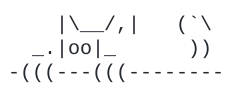

# 👋 Hey guys, I'm Zagif...

Computer engineering senior at Chula. I like figuring out what's actually worth fixing, then building the fix.

📍 Bangkok · 🌐 [zagif.com](https://zagif.com) · 💼 [LinkedIn](https://www.linkedin.com/in/ittichet-thongsang-451021413/)

  

<i>trying to actually work on stuff rather than overthinking it</i>

👀 psst, while you're on <a href="https://zagif.com">zagif.com</a>, tap my card.

---

## 🛠️ Personal projects

Things I built because something annoyed me.

- [bp-logger](https://github.com/Zurusfig/bp-logger): snap a photo of a blood pressure monitor, drop it in a LINE chat, and a bot reads the numbers and files them into a shared table. No more handwritten readings. ([read the story](https://medium.com/@zagif2151382/reading-my-grandfathers-blood-pressure-monitor-with-a-line-bot-3ac6f7661d48))
- [money-tracker-bot](https://github.com/Zurusfig/money-tracker-bot): text what you spent, or send a bank slip, and a LINE bot fills in your budget sheet for you.
- [quick-tools](https://github.com/Zurusfig/quick-tools): the small web tools you keep googling, all in one place. No ads, no sign-up. ([try it](https://tools.zagif.com/))
- [quickmatch](https://github.com/Zurusfig/quickmatch): Spot It, solo. The game builds its own deck, and any two cards always share exactly one symbol. ([play it](https://quickmatch-khaki.vercel.app/))

## 🎉 Just for fun

- [jjk-cam](https://github.com/Zurusfig/jjk-cam) · [dr-strange-cam](https://github.com/Zurusfig/dr-strange-cam) · [reaction-gif-cam](https://github.com/Zurusfig/reaction-gif-cam)

---

## 📚 Course projects

| Course | Project | What it does |
|---|---|---|
| Software Engineering | [ShibaSolver](https://github.com/Zurusfig/ShibaSolver) | A study helper app for students, built by a 9-person Agile team over one semester |
| Software Architecture | [fishertimer](https://github.com/neennera/fishertimer) | A study timer where focus sessions grow a fish tank. Study alongside others in real time and climb the leaderboard. Built as 7 Go microservices |
| Software Development Practice 2 | [EventTicketingSystem](https://github.com/Zurusfig/EventTicketingSystem) | The Performers: browse live events, request tickets, and let admins run the listings ([demo](https://event-ticketing-system-one.vercel.app)) |
| High Performance Architecture | [HPA_final_project](https://github.com/Zurusfig/HPA_final_project) | Place power plants in as few cities as possible so every city is covered. A parallel C solver that proves the answer is optimal when it can |
| Computer Networks | [socket-programming-project](https://github.com/tangenn/socket-programming-project) | A real-time chat app with chat rooms, group chats and online status, plus rock-paper-scissors you can play inside the chat. All over Socket.IO |
| Pattern Recognition | [nca_demo](https://github.com/Zurusfig/nca_demo) | Watch a pixel-art tree grow from a single cell, then use sliders to change how much sunlight and fertilizer it gets. Based on Growing Neural Cellular Automata ([demo](https://nca-demo-nng1.vercel.app/)) |
| Programming Methodology | [super-tictactoe-ultimate](https://github.com/Zurusfig/super-tictactoe-ultimate) | Ultimate Tic-Tac-Toe on a board of nine small games, with item drops you can craft into power-ups |

---

## 🧰 Tech I work with

**Languages**
 

**Frontend**
 

**Backend & data**
 

**Tools**
 

---

## 🐍 Snake vs my commits

<picture>
  <source media="(prefers-color-scheme: dark)" srcset="https://raw.githubusercontent.com/Zurusfig/Zurusfig/output/github-snake-dark.svg" />
  <source media="(prefers-color-scheme: light)" srcset="https://raw.githubusercontent.com/Zurusfig/Zurusfig/output/github-snake.svg" />
  
</picture>

---

thanks for stopping by ✌️

  

